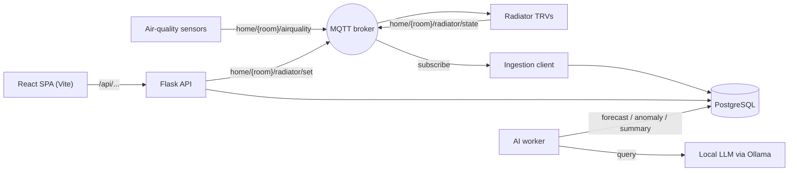

# Home Climate Control

A self-hosted system for **monitoring indoor air quality and controlling heating** across the rooms of a home. Sensors publish readings over MQTT; the system stores them, forecasts short-term trends, flags anomalies, generates plain-language summaries with a local LLM, and controls smart radiator valves (TRVs). A React single-page app consumes the backend's JSON API.

It is hardware-agnostic: a mock sensor publisher and a mock radiator let the entire pipeline run and be developed without any physical devices. Real ESPHome / Zigbee hardware publishes to the same MQTT topics, so swapping it in requires no application changes.

---

## Overview

The system is built from decoupled services communicating over an MQTT broker and a PostgreSQL database, with a React SPA on top of a Flask JSON API:



---

## Features

- Multi-room air-quality monitoring (CO₂, PM2.5, VOC, temperature, humidity) with per-metric status bands.
- Short-term per-metric **forecasting** (linear trend projection).
- **Anomaly detection** on the latest reading per metric (scikit-learn `IsolationForest`).
- Optional **natural-language summaries** via a local LLM (Ollama) — no external API, no cost; degrades gracefully when unavailable.
- **Radiator control**: set a target temperature per room from the dashboard; the system publishes the command and tracks valve state.
- 24-hour per-room history charts.
- **React SPA** with a macOS-style interface.
- **Mock sensor and mock radiator** for full local development without hardware.
- Local development stack (broker, database, cache) via Docker Compose.

---

## Tech stack

| Layer            | Technology                                              |
|------------------|---------------------------------------------------------|
| Frontend         | React, Vite, TypeScript, Tailwind CSS, Recharts         |
| Web API          | Flask, Flask-WTF (CSRF), Flask-Limiter                  |
| Messaging        | MQTT (Eclipse Mosquitto), paho-mqtt                     |
| Storage          | PostgreSQL (psycopg2)                                    |
| Rate-limit store | Redis                                                    |
| AI / analytics   | NumPy, scikit-learn, Ollama (local LLM, optional)       |

---

## Repository structure

```
app/
├── docker-compose.dev.yml      # local broker + Postgres + Redis (credentials from .env)
├── .env.example                # template for the gitignored .env
├── mosquitto/mosquitto.conf    # broker config (dev)
├── backend/
│   ├── application.py          # Flask JSON API; serves the built SPA in production
│   ├── mqtt_client.py          # ingestion (readings + radiator state) + command publish
│   ├── sensors/                # SensorReading model + mock air-quality publisher
│   ├── control/                # RadiatorState model + mock TRV
│   ├── ai/                     # forecasting, anomaly detection, LLM summary, worker
│   └── database/               # schema.sql, data access
└── frontend/                   # React + Vite + TypeScript + Tailwind SPA
    └── src/
        ├── App.tsx
        ├── api.ts
        └── components/         # RoomCard, MetricTile, InsightsPanel, RadiatorControl, HistoryView
```

---

## Prerequisites

- Python 3.10+
- Node.js 18+
- Docker (for the local broker, database, and cache)
- Optional: [Ollama](https://ollama.com) with a small model (e.g. `llama3.2:3b`) for natural-language summaries

---

## Running locally

All backend commands run from `app/backend`; infrastructure commands from `app/`.

### 1. Configure credentials

Copy the template to a gitignored `.env` (used by Docker Compose for Postgres):

```bash
cd app
cp .env.example .env
# edit .env: set POSTGRES_PASSWORD, POSTGRES_DB=home_climate
```

Create `app/backend/config/db_config.yaml` (also gitignored) with matching values:

```yaml
DATABASES:
  default:
    NAME: "home_climate"
    USER: "postgres"
    PASSWORD: "postgres"   # must equal POSTGRES_PASSWORD in .env
    HOST: "localhost"
    PORT: "5432"
```

### 2. Start infrastructure and load the schema

```bash
cd app
docker compose -f docker-compose.dev.yml up -d
docker compose -f docker-compose.dev.yml exec -T postgres \
  psql -U postgres -d home_climate < backend/database/schema.sql
```

### 3. Install Python dependencies

```bash
cd backend
pip install -r requirements.txt
pip install -r ai/requirements.txt   # for the AI worker
```

### 4. Run the backend API

```bash
export FLASK_SECRET_KEY="$(python -c 'import secrets; print(secrets.token_hex(32))')"
export REDIS_URL="redis://localhost:6379"
python application.py
```

The API is served at `http://localhost:8000`.

### 5. Run the mock data sources (no hardware required)

In separate terminals, from `app/backend`:

```bash
python -m sensors.mock_publisher    # air-quality readings
python -m control.mock_radiator     # radiator (TRV) simulation
```

### 6. Run the AI worker (optional)

```bash
# Ollama running for summaries (optional): the worker skips them if it is not
python -m ai.worker
```

### 7. Run the frontend

```bash
cd app/frontend
npm install
npm run dev     # Vite dev server at http://localhost:5173, proxies /api to :8000
```

For a production-style run, build the SPA and let Flask serve it at `http://localhost:8000`:

```bash
cd app/frontend && npm run build
```

---

## API endpoints

| Method | Path                          | Purpose                                            |
|--------|-------------------------------|----------------------------------------------------|
| GET    | `/api/rooms`                  | Latest readings, status, insight, radiator per room |
| GET    | `/api/history?room=&hours=`   | Per-room time series                               |
| POST   | `/api/radiator/<room>/set`    | Set a room's target temperature (CSRF-protected)   |
| GET    | `/api/csrf-token`             | CSRF token for the SPA to send on POSTs            |

---

## MQTT topics and payloads

| Direction        | Topic                          | Payload                                                       |
|------------------|--------------------------------|--------------------------------------------------------------|
| Sensor → system  | `home/<room>/airquality`       | `{room, timestamp, co2, pm25, voc, temperature, humidity}`   |
| TRV → system     | `home/<room>/radiator/state`   | `{room, timestamp, current_temp, target_temp, valve, mode}`  |
| System → TRV     | `home/<room>/radiator/set`     | `{target_temp}`                                              |

Real hardware (ESPHome devices, or Zigbee TRVs bridged via Zigbee2MQTT) publishes and accepts the same topics.

---

## Configuration

Backend environment variables (defaults shown):

| Variable                        | Default                      | Purpose                             |
|---------------------------------|------------------------------|-------------------------------------|
| `FLASK_SECRET_KEY`              | *(required)*                 | Flask session signing key           |
| `REDIS_URL`                     | `memory://`                  | Rate-limiter storage                |
| `MQTT_HOST` / `MQTT_PORT`       | `localhost` / `1883`         | Broker address                      |
| `MQTT_TLS`                      | `false`                      | Enable TLS to the broker            |
| `OLLAMA_URL` / `OLLAMA_MODEL`   | `http://localhost:11434` / `llama3.2:3b` | Local LLM for summaries |
| `AI_INTERVAL` / `AI_HISTORY_HOURS` | `300` / `6`               | AI worker cadence and history window |
| `MOCK_INTERVAL` / `MOCK_ROOMS`  | `5` / `living_room,bedroom,office` | Mock settings                 |

Docker Compose reads `POSTGRES_USER`, `POSTGRES_PASSWORD`, and `POSTGRES_DB` from `app/.env` (gitignored). The backend reads its database connection from `app/backend/config/db_config.yaml` (gitignored); its password must match `POSTGRES_PASSWORD`.

---

## Hardware (production)

- **Air-quality sensing**: an ESP32 with CO₂ (SCD4x), PM2.5 (PMS5003/SPS30), VOC (SGP41), and temperature/humidity (BME280) sensors running ESPHome; or an off-the-shelf open-source monitor that can publish to a local MQTT broker.
- **Radiator control**: smart Zigbee thermostatic radiator valves (e.g. Sonoff TRVZB, Eurotronic Spirit Zigbee), a Zigbee USB coordinator, and Zigbee2MQTT bridging the valves onto MQTT. Valves screw onto the existing radiator valve (standard M30×1.5 thread; adapters for Danfoss variants) — no plumbing or mains wiring.
- **Host**: any always-on machine (e.g. a Raspberry Pi) running the broker, database, and services.

---

## Roadmap

- AI-driven automation linking insights to control (e.g. adjust heating based on occupancy, air quality, or schedule).
- Authenticated multi-user access for the control API.
- Time-series storage optimization for long-term history.