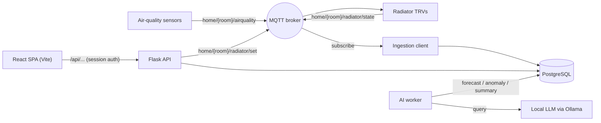

# Home Climate Control

A self-hosted system for **monitoring indoor air quality and controlling heating** across the rooms of a home. Sensors publish readings over MQTT; the system stores them, forecasts short-term trends, flags anomalies, generates plain-language summaries with a local LLM, and controls smart radiator valves (TRVs). A React single-page app sits on top of an authenticated Flask JSON API, reachable securely from anywhere over a private network.

It is hardware-agnostic: a mock sensor publisher and a mock radiator let the entire pipeline run and be developed without any physical devices. Real ESPHome / Zigbee hardware publishes to the same MQTT topics, so swapping it in requires no application changes.

---

## Overview

Decoupled services communicate over an MQTT broker and a PostgreSQL database. A React SPA talks to a Flask JSON API behind a login:



---

## Features

- Multi-room air-quality monitoring (CO₂, PM2.5, VOC, temperature, humidity) with per-metric status bands.
- Short-term per-metric **forecasting** and **anomaly detection** (scikit-learn).
- Optional **natural-language summaries** via a local LLM (Ollama) — no external API, no cost.
- **Radiator control**: set a target temperature per room from the dashboard.
- 24-hour per-room history charts.
- **React SPA** with a macOS-style interface.
- **Authentication**: username/password login (hashed), session cookies, roles, and an audit log.
- **MQTT security**: authenticated broker with per-identity topic ACLs (optional TLS).
- **Secure remote access**: reachable over a private Tailscale network with HTTPS; no public exposure.
- **Mock sensor and mock radiator** for full local development without hardware.

---

## Tech stack

| Layer            | Technology                                              |
|------------------|---------------------------------------------------------|
| Frontend         | React, Vite, TypeScript, Tailwind CSS, Recharts         |
| Web API          | Flask, Flask-Login, Flask-WTF (CSRF), Flask-Limiter     |
| WSGI (prod)      | gunicorn                                                 |
| Messaging        | MQTT (Eclipse Mosquitto), paho-mqtt                     |
| Storage          | PostgreSQL (psycopg2)                                    |
| Rate-limit store | Redis                                                    |
| AI / analytics   | NumPy, scikit-learn, Ollama (local LLM, optional)       |

---

## Repository structure

```
app/
├── docker-compose.dev.yml      # broker + Postgres + Redis (ports bound to localhost)
├── .env.example                # template for the gitignored .env
├── mosquitto/
│   ├── mosquitto.conf          # authenticated broker config (anonymous off)
│   ├── acl                     # per-identity topic permissions
│   ├── setup-auth.sh           # generates the hashed password file
│   └── gen-certs.sh            # generates a CA + server cert for TLS (optional)
├── backend/
│   ├── application.py          # Flask JSON API + auth; serves the built SPA in prod
│   ├── run.sh                  # production launcher (loads .env, runs gunicorn)
│   ├── mqtt_client.py          # ingestion + command publish (auth/TLS aware)
│   ├── auth/                   # login/session helpers + user management CLI
│   ├── sensors/                # SensorReading model + mock air-quality publisher
│   ├── control/                # RadiatorState model + mock TRV
│   ├── ai/                     # forecasting, anomaly detection, LLM summary, worker
│   └── database/               # schema.sql, data access
└── frontend/                   # React + Vite + TypeScript + Tailwind SPA
```

---

## Prerequisites

- Python 3.10+, Node.js 18+, Docker
- Optional: [Ollama](https://ollama.com) with a small model (e.g. `llama3.2:3b`) for summaries
- For remote access: [Tailscale](https://tailscale.com) (free Personal plan)

---

## Running locally (development)

Backend commands run from `app/backend`; infrastructure from `app/`.

### 1. Configure credentials

Copy the template to a gitignored `.env` and fill it in:

```bash
cd app
cp .env.example .env
```

`.env` should contain:

```
POSTGRES_USER=postgres
POSTGRES_PASSWORD=...
POSTGRES_DB=home_climate
FLASK_SECRET_KEY=...            # python -c 'import secrets; print(secrets.token_hex(32))'
COOKIE_SECURE=false             # true in production (HTTPS)
MQTT_APP_PASSWORD=...
MQTT_SENSOR_PASSWORD=...
MQTT_TRV_PASSWORD=...
```

Also create `app/backend/config/db_config.yaml` (gitignored) with the same DB password:

```yaml
DATABASES:
  default:
    NAME: "home_climate"
    USER: "postgres"
    PASSWORD: "..."             # equals POSTGRES_PASSWORD
    HOST: "localhost"
    PORT: "5432"
```

### 2. Set up the MQTT broker auth, then start infrastructure

Generate the broker's hashed password file **before** starting the broker:

```bash
cd app/mosquitto
MQTT_APP_PASSWORD=... MQTT_SENSOR_PASSWORD=... MQTT_TRV_PASSWORD=... ./setup-auth.sh
```

Start the stack and load the schema:

```bash
cd app
docker compose -f docker-compose.dev.yml up -d
docker compose -f docker-compose.dev.yml exec -T postgres \
  psql -U postgres -d home_climate < backend/database/schema.sql
```

### 3. Create application users

```bash
cd app/backend
pip install -r requirements.txt
pip install -r ai/requirements.txt      # for the AI worker
python -m auth.manage <you> --role admin
python -m auth.manage <second-user>
```

### 4. Run the services

Each MQTT client authenticates with its own identity (matching the broker ACLs):

```bash
# Backend API (identity: app). Dev server:
MQTT_USERNAME=app MQTT_PASSWORD="$MQTT_APP_PASSWORD" \
  FLASK_SECRET_KEY=... REDIS_URL=redis://localhost:6379 python application.py

# Mocks (separate terminals)
MQTT_USERNAME=sensor MQTT_PASSWORD="$MQTT_SENSOR_PASSWORD" python -m sensors.mock_publisher
MQTT_USERNAME=trv    MQTT_PASSWORD="$MQTT_TRV_PASSWORD"    python -m control.mock_radiator

# AI worker (no MQTT; optional)
python -m ai.worker
```

### 5. Run the frontend

```bash
cd app/frontend
npm install
npm run dev     # Vite at http://localhost:5173, proxies /api to :8000
```

You'll get a login screen; sign in with one of the accounts created in step 3.

---

## Authentication

- Users live in a `users` table with **hashed** passwords (werkzeug); usernames are case-insensitive.
- Login is a Flask-Login session: `POST /api/login`, `POST /api/logout`, `GET /api/me`.
- The **whole API requires login**; the SPA shows the login screen until authenticated.
- Cookies are `HttpOnly`, `SameSite=Lax`, and `Secure` in production; sessions expire after `SESSION_LIFETIME_DAYS` (default 7, sliding). Login is rate-limited and CSRF-protected.
- Roles (`admin` / `user`) are stored; the audit endpoint (`GET /api/audit`) is admin-only.
- An **audit log** records `login`, `login_failed`, `logout`, and `radiator_set` (who, what, when).

Manage users with `python -m auth.manage <username> [--role admin|user]`.

---

## MQTT security

- The broker requires **authentication** (anonymous access disabled). `mosquitto/setup-auth.sh` writes the hashed password file for three identities: `app` (backend), `sensor` (air-quality devices), `trv` (radiator valves).
- **ACLs** (`mosquitto/acl`) restrict each identity to only its topics — a sensor can publish air-quality data but cannot command the heating, and vice versa.
- **TLS (optional, for real devices)**: run `mosquitto/gen-certs.sh`, uncomment the `8883` block in `mosquitto.conf`, restart the broker, and point devices at `MQTT_PORT=8883 MQTT_TLS=true MQTT_CA_CERT=.../ca.crt`. Local services on the same host can stay on `1883`.

Secrets (`mosquitto/passwd`, `mosquitto/certs/`) are gitignored.

---

## Production (gunicorn)

Run the app under gunicorn instead of the Flask dev server. A launcher that loads `.env` is provided:

```bash
cd app/backend
./run.sh          # loads .env, binds 127.0.0.1:8000, runs gunicorn -w 1 --threads 4
```

Notes:
- **One worker** (`-w 1`): the backend subscribes to MQTT at startup, so multiple workers would create duplicate ingestion. Use threads for concurrency. (To scale out, move ingestion into its own process and run the web app publish-only.)
- Use a **fixed** `FLASK_SECRET_KEY` (in `.env`) so restarts don't invalidate sessions.
- Set `COOKIE_SECURE=true` behind HTTPS.
- Build the SPA (`npm run build`) so Flask serves it on the same port.

---

## Remote access & HTTPS (Tailscale)

The app is not exposed to the public internet. Remote access is over a private [Tailscale](https://tailscale.com) network (free Personal plan):

1. Install Tailscale on the host and your devices; sign in to the same account.
2. Run the app bound to localhost (`run.sh` binds `127.0.0.1:8000`).
3. Enable **HTTPS certificates** in the Tailscale admin console (DNS → Features), then:
   ```bash
   tailscale serve --bg 8000
   ```
   This serves `https://<host>.<tailnet>.ts.net` with a valid certificate, reachable only from your tailnet devices.

### Network binding

All services bind to **localhost only**:
- The app: gunicorn `-b 127.0.0.1:8000`.
- Docker services: ports published as `127.0.0.1:<port>:<port>` in `docker-compose.dev.yml`.

So nothing is reachable from the LAN or the internet directly — only from the host and, remotely, through the Tailscale tunnel. (When adding real networked sensors later, expose only the TLS broker port to the LAN.)

---

## API endpoints

| Method | Path                         | Auth        | Purpose                                   |
|--------|------------------------------|-------------|-------------------------------------------|
| POST   | `/api/login`                 | public      | Authenticate (username, password)         |
| POST   | `/api/logout`                | session     | End the session                           |
| GET    | `/api/me`                    | public      | Current auth status                       |
| GET    | `/api/csrf-token`            | public      | CSRF token for POSTs                       |
| GET    | `/api/rooms`                 | session     | Latest readings, status, insight, radiator |
| GET    | `/api/history?room=&hours=`  | session     | Per-room time series                      |
| POST   | `/api/radiator/<room>/set`   | session     | Set a room's target temperature           |
| GET    | `/api/audit`                 | admin       | Recent audit-log entries                  |

---

## MQTT topics

| Direction        | Topic                          | Payload                                                       |
|------------------|--------------------------------|--------------------------------------------------------------|
| Sensor → system  | `home/<room>/airquality`       | `{room, timestamp, co2, pm25, voc, temperature, humidity}`   |
| TRV → system     | `home/<room>/radiator/state`   | `{room, timestamp, current_temp, target_temp, valve, mode}`  |
| System → TRV     | `home/<room>/radiator/set`     | `{target_temp}`                                              |

---

## Configuration

Key backend environment variables (defaults shown):

| Variable                          | Default                  | Purpose                                 |
|-----------------------------------|--------------------------|-----------------------------------------|
| `FLASK_SECRET_KEY`                | *(required)*             | Session signing key (keep fixed)        |
| `COOKIE_SECURE`                   | `false`                  | `Secure` flag on cookies (true on HTTPS)|
| `SESSION_LIFETIME_DAYS`           | `7`                      | Session expiry                          |
| `REDIS_URL`                       | `memory://`              | Rate-limiter storage                    |
| `MQTT_HOST` / `MQTT_PORT`         | `localhost` / `1883`     | Broker address                          |
| `MQTT_USERNAME` / `MQTT_PASSWORD` | *(required by broker)*   | MQTT identity for this process          |
| `MQTT_TLS` / `MQTT_CA_CERT`       | `false` / —              | TLS to the broker + CA cert path        |
| `OLLAMA_URL` / `OLLAMA_MODEL`     | `localhost:11434` / `llama3.2:3b` | Local LLM for summaries        |
| `AI_INTERVAL` / `AI_HISTORY_HOURS`| `300` / `6`              | AI worker cadence and window            |

Compose reads `POSTGRES_*` from `app/.env`; the backend reads its DB connection from `app/backend/config/db_config.yaml`.

---

## Hardware (production)

- **Air-quality sensing**: an ESP32 with CO₂ (SCD4x), PM2.5 (PMS5003/SPS30), VOC (SGP41), temperature/humidity (BME280) running ESPHome; or an off-the-shelf open-source monitor publishing to MQTT.
- **Radiator control**: smart Zigbee TRVs (e.g. Sonoff TRVZB, Eurotronic Spirit Zigbee) + a Zigbee USB coordinator + Zigbee2MQTT. Valves screw onto the existing radiator valve (M30×1.5; adapters for Danfoss) — no plumbing or mains wiring.
- **Host**: an always-on machine (e.g. a Raspberry Pi) running the broker, database, and services.

---

## Roadmap

- AI-driven automation linking insights to control (adjust heating by occupancy, air quality, or schedule).
- Dedicated ingestion process to allow multi-worker scale-out.
- Time-series storage optimization for long-term history.
