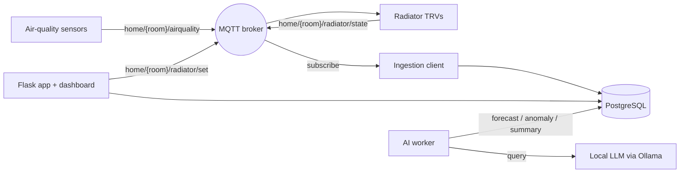

# Home Climate Control

A self-hosted system for **monitoring indoor air quality and controlling heating** across the rooms of a home. Sensors publish readings over MQTT; the system stores them, forecasts short-term trends, flags anomalies, generates plain-language summaries with a local LLM, and controls smart radiator valves (TRVs) — all from a single web dashboard.

It is hardware-agnostic: a mock sensor publisher and a mock radiator let the entire pipeline run and be developed without any physical devices. Real ESPHome / Zigbee hardware publishes to the same MQTT topics, so swapping it in requires no application changes.

---

## Overview

The system is built from decoupled services communicating over an MQTT broker and a PostgreSQL database:

- **Sensors** publish air-quality readings (CO₂, PM2.5, VOC, temperature, humidity) per room.
- **Radiator valves (TRVs)** publish their state (current temperature, target, valve position) and accept target-temperature commands.
- An **ingestion client** persists readings and radiator state, and publishes radiator commands.
- A **Flask web app** serves the dashboard and a control API.
- An **AI worker** periodically computes forecasts, anomaly flags, and a natural-language summary, written back to the database.



---

## Features

- Multi-room air-quality monitoring (CO₂, PM2.5, VOC, temperature, humidity) with per-metric status bands.
- Short-term per-metric **forecasting** (linear trend projection).
- **Anomaly detection** on the latest reading per metric (scikit-learn `IsolationForest`).
- Optional **natural-language summaries** via a local LLM (Ollama) — no external API, no cost; degrades gracefully when unavailable.
- **Radiator control**: set a target temperature per room from the dashboard; the system publishes the command and tracks valve state.
- 24-hour per-room history charts.
- **Mock sensor and mock radiator** for full local development without hardware.
- Local development stack (broker, database, cache) via Docker Compose.

---

## Tech stack

| Layer            | Technology                                             |
|------------------|--------------------------------------------------------|
| Web app / API    | Flask, Flask-WTF (CSRF), Flask-Limiter                 |
| Messaging        | MQTT (Eclipse Mosquitto), paho-mqtt                    |
| Storage          | PostgreSQL (psycopg2)                                   |
| Rate-limit store | Redis                                                   |
| AI / analytics   | NumPy, scikit-learn, Ollama (local LLM, optional)      |
| Frontend         | Server-rendered templates, Plotly (history charts)     |

---

## Repository structure

```
app/
├── docker-compose.dev.yml      # local broker + Postgres + Redis
├── mosquitto/mosquitto.conf    # broker config (dev)
├── backend/
│   ├── application.py          # Flask app: dashboard, history, control API
│   ├── mqtt_client.py          # ingestion (readings + radiator state) + command publish
│   ├── sensors/
│   │   ├── models.py           # SensorReading model + status classification
│   │   └── mock_publisher.py   # mock air-quality sensors
│   ├── control/
│   │   ├── models.py           # RadiatorState model
│   │   └── mock_radiator.py    # mock TRV (heating simulation)
│   ├── ai/
│   │   ├── forecasting.py      # per-metric trend forecast
│   │   ├── anomaly.py          # IsolationForest anomaly detection
│   │   ├── summary.py          # local LLM summary (Ollama)
│   │   └── worker.py           # periodic AI insights worker
│   └── database/
│       ├── schema.sql          # readings, insights, radiator_state tables
│       ├── db.py               # data access
│       └── database_connection.py
└── frontend/templates/         # dashboard, history, contact
```

---

## Prerequisites

- Python 3.10+
- Docker (for the local broker, database, and cache)
- Optional: [Ollama](https://ollama.com) with a small model (e.g. `llama3.2:3b`) for natural-language summaries

---

## Running locally

All commands are run from the `app/` directory unless noted.

### 1. Start infrastructure

```bash
docker compose -f docker-compose.dev.yml up -d
```

This starts Mosquitto (`:1883`), PostgreSQL (`:5432`), and Redis (`:6379`).

### 2. Create the database schema

```bash
docker compose -f docker-compose.dev.yml exec -T postgres \
  psql -U postgres -d ventilation < backend/database/schema.sql
```

### 3. Configure the database connection

Create `backend/config/db_config.yaml` (gitignored):

```yaml
DATABASES:
  default:
    NAME: "ventilation"
    USER: "postgres"
    PASSWORD: "postgres"
    HOST: "localhost"
    PORT: "5432"
```

### 4. Install dependencies

```bash
cd backend
pip install -r requirements.txt
pip install -r ai/requirements.txt   # for the AI worker
```

### 5. Run the application

```bash
export FLASK_SECRET_KEY="$(python -c 'import secrets; print(secrets.token_hex(32))')"
export REDIS_URL="redis://localhost:6379"
export BASIC_AUTH_USER="admin"
export BASIC_AUTH_PASS="change-me"
python application.py
```

The dashboard is served at `http://localhost:8000`.

### 6. Run the mock data sources (no hardware required)

In separate terminals, from `backend/`:

```bash
python -m sensors.mock_publisher    # air-quality readings
python -m control.mock_radiator     # radiator (TRV) simulation
```

### 7. Run the AI worker (optional)

```bash
# Ensure Ollama is running for summaries (optional): ollama serve
python -m ai.worker
```

---

## MQTT topics and payloads

| Direction        | Topic                          | Payload                                                             |
|------------------|--------------------------------|--------------------------------------------------------------------|
| Sensor → system  | `home/<room>/airquality`       | `{room, timestamp, co2, pm25, voc, temperature, humidity}`         |
| TRV → system     | `home/<room>/radiator/state`   | `{room, timestamp, current_temp, target_temp, valve, mode}`       |
| System → TRV     | `home/<room>/radiator/set`     | `{target_temp}`                                                     |

Real hardware (ESPHome devices, or Zigbee TRVs bridged via Zigbee2MQTT) publishes and accepts the same topics.

---

## Configuration

Set via environment variables (defaults shown):

| Variable                        | Default                      | Purpose                                      |
|---------------------------------|------------------------------|----------------------------------------------|
| `FLASK_SECRET_KEY`              | *(required)*                 | Flask session signing key                    |
| `BASIC_AUTH_USER` / `_PASS`     | *(required for `/latest_data`)* | Basic auth for the latest-data endpoint   |
| `REDIS_URL`                     | `memory://`                  | Rate-limiter storage                         |
| `MQTT_HOST` / `MQTT_PORT`       | `localhost` / `1883`         | Broker address                               |
| `MQTT_TLS`                      | `false`                      | Enable TLS to the broker                     |
| `MQTT_USERNAME` / `_PASSWORD`   | *(unset)*                    | Broker credentials                           |
| `OLLAMA_URL` / `OLLAMA_MODEL`   | `http://localhost:11434` / `llama3.2:3b` | Local LLM for summaries          |
| `AI_INTERVAL` / `AI_HISTORY_HOURS` | `300` / `6`               | AI worker cadence and history window         |
| `MOCK_INTERVAL` / `MOCK_ROOMS`  | `5` / `living_room,bedroom,office` | Mock publisher settings                |

The database connection is read from `backend/config/db_config.yaml`.

---

## Hardware (production)

- **Air-quality sensing**: an ESP32 with CO₂ (SCD4x), PM2.5 (PMS5003/SPS30), VOC (SGP41), and temperature/humidity (BME280) sensors running ESPHome; or an off-the-shelf open-source monitor that can publish to a local MQTT broker.
- **Radiator control**: smart Zigbee thermostatic radiator valves (e.g. Sonoff TRVZB, Eurotronic Spirit Zigbee), a Zigbee USB coordinator, and Zigbee2MQTT bridging the valves onto MQTT. Valves screw onto the existing radiator valve (standard M30×1.5 thread; adapters for Danfoss variants) — no plumbing or mains wiring.
- **Host**: any always-on machine (e.g. a Raspberry Pi) running the broker, database, and services.

---

## Roadmap

- AI-driven automation linking insights to control (e.g. adjust heating based on occupancy, air quality, or schedule).
- Authenticated multi-user access for the control API.
- Time-series storage optimization for long-term history.